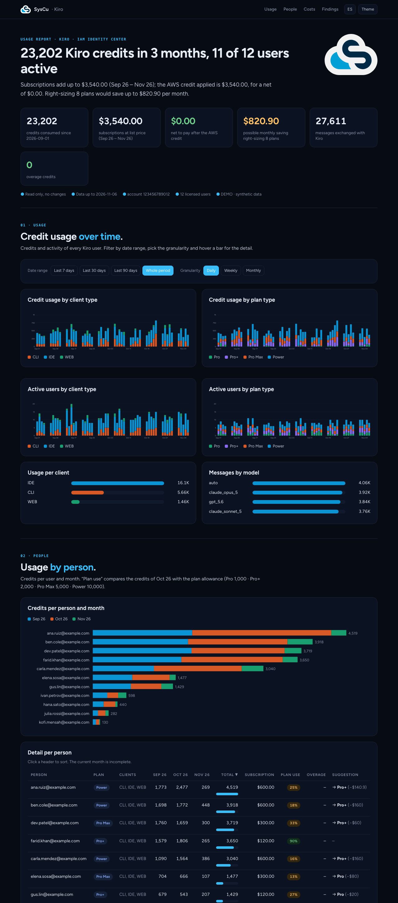

# syscu-kiro-report-usage

[](https://github.com/syscu-es/syscu-kiro-report-usage/actions/workflows/ci.yml)
[](https://pypi.org/project/syscu-kiro-report-usage/)
[](https://pypi.org/project/syscu-kiro-report-usage/)
[](LICENSE)

Generate a **single, self-contained HTML report** of [Kiro](https://kiro.dev) usage and cost **per IAM Identity Center user** — one command, no infrastructure to deploy.



It answers the questions Kiro administrators keep asking:

- Who is using Kiro, on which client (IDE / CLI / Web), and with which models?
- Credits used per day / week / month, by client type and by plan — the same views as the Kiro console dashboard, plus per-person detail.
- What do the subscriptions cost, and how much of it is covered by AWS credits?
- Who is on the wrong plan? Right-sizing suggestions include overage cost ($0.04/credit).
- Which licences are idle?

The output is a static `.html` file (light/dark theme, English/Spanish, date-range and daily/weekly/monthly filters, tooltips, print-friendly). Share it as an attachment; nothing is uploaded anywhere.

## Quick start

Requires Python 3.10+. AWS access is read-only ([permissions](docs/PERMISSIONS.md)) and is not needed for `--demo`.

```bash
pip install syscu-kiro-report-usage            # from PyPI
pip install git+https://github.com/syscu-es/syscu-kiro-report-usage.git   # latest from GitHub
# or from a clone:  pip install .     (development: pip install -e ".[dev]")

kiro-report --demo --open        # preview with synthetic data, no AWS needed
kiro-report                      # interactive: pick or sign in to ANY AWS account, then the period
```

Unattended:

```bash
kiro-report --profile my-sso-profile --sso-login --last 6 --out kiro.html
kiro-report --profile prod --month 2026-10 --lang en --anonymize
```

### Works against any account, interactively

Run `kiro-report` on a terminal and it asks, step by step:

1. **Account** — choose one of your local profiles (`~/.aws/config` / `~/.aws/credentials`), the default credential chain, or **“Sign in with AWS IAM Identity Center”**.
2. **IAM Identity Center sign-in (no profile needed)** — enter your start URL (`https://<name>.awsapps.com/start`) and region, approve in the browser (device authorization, the same flow as `aws sso login`), then pick any **account** and **role** you can reach (type text to filter long lists). Tokens and temporary credentials stay in memory; nothing is written to disk.
3. **Period** — last full month, current month, last 3/6/12 months, or a custom `YYYY-MM[:YYYY-MM]` range.

For an existing SSO *profile* with an expired session it offers to run `aws sso login` for you (`--sso-login` does it without asking). Everything is also scriptable: `--sso-start-url … --sso-account <id|name> --sso-role <name>`; `-y/--yes` never prompts. Set `KIRO_REPORT_SSO_START_URL` to pre-fill the start URL.

## Where the data comes from

| Source | Gives you | How to enable |
|---|---|---|
| **Kiro user activity report** (daily CSVs in S3) | client type (IDE/CLI/Web), plan, credits, **overage**, messages, models, user e-mail, new users | Kiro console → *Settings* → *User activity report* → CSV → S3 bucket. [Docs](https://kiro.dev/docs/enterprise/monitor-and-track/user-activity/) |
| **AWS Cost and Usage Report** (Data Exports, parquet) | real subscription lines, AWS credits applied, credits per Identity Center user (`line_item_resource_id`) | Billing → Data Exports → *Standard data export (CUR 2.0)* with resource IDs, parquet |
| **IAM Identity Center** | user names when the activity report has no e-mail | automatic |

Either source can be missing: with only the activity report, costs are *estimated at list price*; with only the CUR you get per-person credits and costs but no client/plan/model breakdown (the report tells you how to enable the rest). Sources are auto-discovered; override with `--cur-export`, `--cur-bucket/--cur-prefix`, `--activity-bucket/--activity-prefix`.

Required AWS permissions are read-only — see [docs/PERMISSIONS.md](docs/PERMISSIONS.md).

## Options

| Flag | Purpose |
|---|---|
| `--profile`, `--region`, `--sso-login` | pick a local profile; refresh an expired SSO session |
| `--sso-start-url`, `--sso-region`, `--sso-account`, `--sso-role` | sign in to any account through IAM Identity Center, no profile needed |
| `--month`, `--since`/`--until`, `--last N` | period (default: last 3 months, or asked) |
| `--no-cur`, `--no-activity` | skip a source |
| `--lang en\|es` | report language (also switchable inside the report) |
| `--anonymize` | replace users with `user-NN` before sharing |
| `--brand`, `--logo`, `--no-logo`, `--no-embed-font` | white-label the report |
| `--json FILE` | also dump the aggregated data (feed your own dashboards) |
| `--demo` | synthetic data, no AWS |

## How it works

```
CUR (parquet) ─┐                                   ┌─> report.html (inline CSS/JS/SVG, offline)
               ├─> model.build_report (JSON) ──────┤
Kiro CSVs ─────┘     merge by user id,             └─> --json
IAM Identity Center   tier right-sizing
```

`src/kiro_report/`: `cli` (prompts) · `aws` (profiles/SSO) · `cur` · `activity` · `identity` · `model` (merge + recommendations) · `tiers` (plan catalogue) · `render` + `templates/report.html`.

## Related AWS projects

This tool is a lightweight, local alternative to heavier setups; use them if you need always-on dashboards:

- [Kiro User Activity Dashboard](https://docs.aws.amazon.com/guidance/latest/cloud-intelligence-dashboards/kiro-user-activity-dashboard.html) (Cloud Intelligence Dashboards, QuickSight)
- [`aws-samples/sample-kiro-cost-optimizer`](https://github.com/aws-samples/sample-kiro-cost-optimizer) (serverless, e-mail recommendations)
- [`aws-samples/sample-kiro-user-analytics-dashboard`](https://github.com/aws-samples/sample-kiro-user-analytics-dashboard)

## Privacy

Reports contain user e-mails and usage. Generated `kiro-report-*.html/json` are git-ignored; use `--anonymize` before sharing. Nothing leaves your machine except the AWS API calls you authorise.

## Development

```bash
pip install -e ".[dev]"
pytest --cov=kiro_report
ruff check .
```

Plan prices/allowances live in `src/kiro_report/tiers.py` (Kiro pricing is subject to change).

Contributions are welcome: see [CONTRIBUTING.md](CONTRIBUTING.md). Report vulnerabilities privately as described in [SECURITY.md](SECURITY.md). Changes are tracked in [CHANGELOG.md](CHANGELOG.md).

## Releasing

Releases are published to PyPI by GitHub Actions with [Trusted Publishing](https://docs.pypi.org/trusted-publishers/) (OIDC, no stored tokens): `.github/workflows/release.yml`. To release, bump `version` in `pyproject.toml`, merge, then push a tag `vX.Y.Z` (the workflow refuses a tag that does not match the version). Run the workflow manually with target `testpypi` to rehearse.

## License

MIT for the code. The SysCu logo in `src/kiro_report/assets/` is a brand asset and is **not** covered by the MIT license (replace it with `--logo`, or drop it with `--no-logo`); the bundled Figtree font is SIL OFL 1.1. See `LICENSE` and `src/kiro_report/assets/NOTICE.md`.
